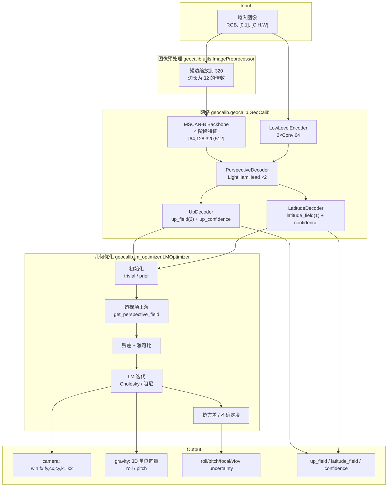
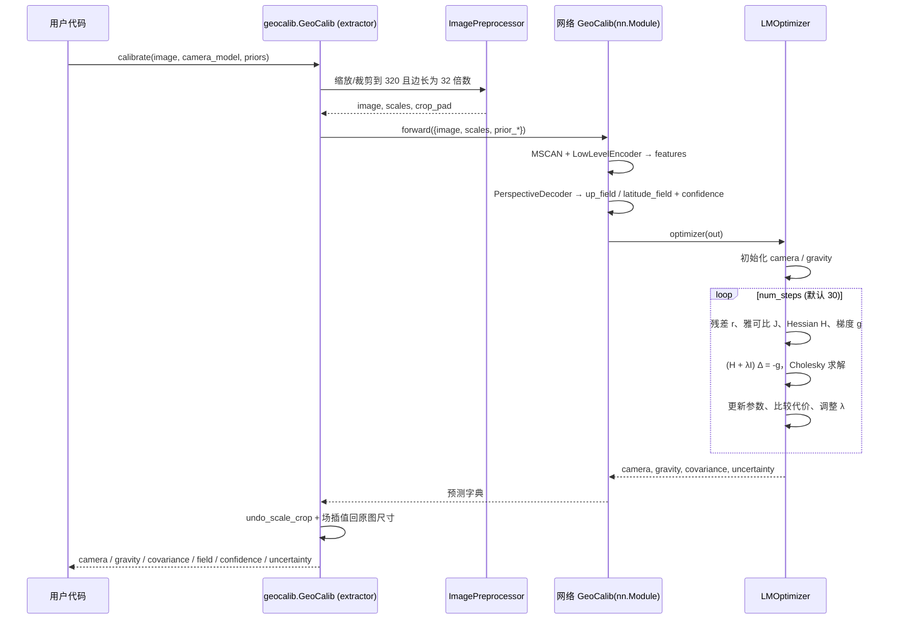

# 01 · 整体架构

## 1. 仓库定位

GeoCalib 是一个“**学习式预测 + 几何优化**”的单图像相机标定系统。仓库同时提供：

- 最小推理包 `geocalib`（可 `pip install -e .`，也可通过 `torch.hub` 加载）；
- 完整训练/评估库 `siclib`（可 `pip install -e siclib`）；
- 两个预训练权重（`pinhole`、`distorted`）；
- Gradio 在线 Demo、摄像头交互 Demo、Jupyter Demo；
- OpenPano 数据集构建脚本与 5 个评测基准。

## 2. 顶层目录结构

```text
/workspace
├── geocalib/                     # 轻量推理包
│   ├── __init__.py               # 导出 GeoCalib，配置 logging
│   ├── extractor.py              # 对外接口：GeoCalib(weights).calibrate(...)
│   ├── geocalib.py               # 网络结构：MSCAN + 低层编码器 + 透视场解码器
│   ├── camera.py                 # 相机模型（pinhole / radial / divisional）
│   ├── gravity.py                # 重力向量张量类
│   ├── perspective_fields.py     # 透视场正演与雅可比
│   ├── lm_optimizer.py           # 可微 LM 优化器
│   ├── misc.py                   # TensorWrapper、流形、通用雅可比
│   ├── modules.py                # MSCAN / LightHamHead / Hamburger 等网络模块
│   ├── utils.py                  # 图像预处理、坐标/角度转换、可视化打印
│   ├── viz2d.py                  # 2D 绘图工具
│   └── interactive_demo.py       # 摄像头交互 Demo
├── siclib/                       # 训练 / 评估库
│   ├── train.py                  # 通用训练入口
│   ├── settings.py               # DATA_PATH / TRAINING_PATH / EVAL_PATH
│   ├── pose_estimation.py        # 与 poselib/pycolmap 结合的绝对位姿估计
│   ├── configs/                  # Hydra 训练配置
│   │   ├── geocalib.yaml
│   │   ├── geocalib-radial.yaml
│   │   ├── model/{geocalib,deepcalib}.yaml
│   │   └── train/{geocalib,deepcalib}.yaml
│   ├── models/                   # 模型体系
│   │   ├── base_model.py         # BaseModel / MetaModel
│   │   ├── __init__.py           # get_model 动态导入
│   │   ├── extractor.py          # siclib 版推理接口 + VP
│   │   ├── cache_loader.py       # 从 h5 读取预测
│   │   ├── networks/             # geocalib / geocalib_pretrained / deepcalib / dust3r
│   │   ├── encoders/             # mscan / low_level_encoder / resnet / vgg
│   │   ├── decoders/             # perspective/up/latitude/fpn/light_hamburger
│   │   ├── optimization/         # lm_optimizer / inference_optimizer / losses / ransac ...
│   │   └── utils/                # modules / metrics / perspective_encoding
│   ├── geometry/                 # 相机、重力、流形、雅可比、透视场
│   ├── datasets/                 # BaseDataset / SimpleDataset / 增强 / OpenPano 生成
│   ├── eval/                     # 评估流水线与各 benchmark
│   ├── utils/                    # 转换、实验管理、导出、图像/张量、工具、日志
│   └── visualization/            # 可视化
├── assets/                       # 示例图片
├── hubconf.py                    # torch.hub 入口
├── gradio_app.py                 # Gradio Demo
├── demo.ipynb                    # Notebook Demo
├── pyproject.toml                # geocalib 包定义
├── requirements.txt              # geocalib 依赖
└── README.md
```

## 3. 双包职责划分

| 维度 | `geocalib` | `siclib` |
| --- | --- | --- |
| 目标 | 推理、Demo、集成 | 训练、评估、数据集、实验管理 |
| 配置方式 | 构造函数参数 + 少量默认配置 | Hydra / OmegaConf 配置树 |
| 网络实现 | 直接实例化 `MSCAN()` 等 | `get_model(name)` 动态导入，可替换 |
| 损失/指标 | 无（仅推理） | 有，统一 `loss()` / `metrics()` 接口 |
| 优化器 | `LMOptimizer`（`nn.Module`） | `LMOptimizer(BaseModel)`，可配损失与初始化器 |
| 权重来源 | GitHub Release 自动下载 | `weights/` 或训练实验 |
| 输出 | `camera / gravity / field / uncertainty` | 同上，另加训练损失与评估指标 |

## 4. 系统架构图



## 5. 推理数据流（单图）



## 6. 训练数据流

```text
OpenPano 全景图
   │  create_dataset_from_pano.py（采样 roll/pitch/vFoV/畸变，固定 640×640）
   ▼
透视图像 + CSV 元数据（width,height,vfov,roll,pitch,k1,k2）
   │  SimpleDataset（读取、增强、缩放、生成 GT 透视场）
   ▼
{batch}: image, camera, gravity, up_field, latitude_field, scales, ...
   │  siclib.train.train()（DDP + AMP）
   ▼
GeoCalib(BaseModel).forward → perspective_decoder + lm_optimizer
   │
   ├─ loss/perspective_total：up / latitude 的 l1 + 不确定度损失
   └─ loss/param_total：LM 优化后相机与重力的参数误差
   ▼
checkpoints → outputs/training/<experiment>/
```

关键点：训练时 LM 优化器也是**可微**的，`param_total` 的梯度会回传到透视场预测，从而让网络学会“产生易于几何拟合的透视场”。

## 7. 评估数据流

```text
benchmark zip（如 lamar2k.zip）
   │  SimplePipeline._init → download_and_extract_benchmark
   ▼
data/<benchmark>/{images, images.csv}
   │  SimpleDataset（identity 增强）
   ▼
export_predictions → outputs/results/<benchmark>/<tag>/predictions.h5
   │  CacheLoader 读取
   ▼
SimplePipeline.run_eval
   ├─ 相机指标：vfov/focal/k1 误差、像素投影误差
   ├─ 重力指标：roll/pitch/gravity 误差
   ├─ 场指标：up/latitude 角度误差
   └─ AUC @ 1/5/10°
   ▼
summaries.json + results.h5 + figures/
```

## 8. 关键设计决策

1. **预测场而非直接回归参数**：网络输出密集的 up/latitude 场，几何优化负责把场“压”成 4~5 个相机参数，泛化性更好。
2. **主点固定为图像中心**：不优化 `cx, cy`，减少自由度并匹配训练数据分布。
3. **焦距由 vFoV 参数化**：优化时约束 vFoV 在 5°~150°（`update_focal` 内 clamp）。
4. **重力用球面流形更新**：避免 3D 单位向量的范数漂移，更新量是 2 维切空间向量。
5. **一个网络、多种相机模型**：同一套权重可切换 `pinhole / simple_radial / radial / simple_divisional`，由优化器切换参数维度。
6. **不确定度来自 LM 协方差**：无需额外训练不确定度头，但网络仍输出逐像素 confidence 用于加权。
7. **配置即实验**：`siclib` 用 Hydra 组合 `data / train / model` 三棵子树，命令行 dotlist 可覆盖任意字段。

## 9. 运行入口一览

| 入口 | 命令 | 说明 |
| --- | --- | --- |
| 推理 API | `from geocalib import GeoCalib` | 最小依赖 |
| torch.hub | `torch.hub.load("cvg/GeoCalib", "GeoCalib")` | 远程加载 |
| Gradio | `python gradio_app.py` | Web Demo |
| 摄像头 | `python -m geocalib.interactive_demo --camera_id 0` | 实时标定 |
| 评估 | `python -m siclib.eval.<benchmark> --conf <cfg>` | 见 07 |
| 训练 | `python -m siclib.train <experiment> --conf geocalib` | 见 08 |
| 数据集 | `python -m siclib.datasets.create_dataset_from_pano --config-name openpano` | 见 06 |

详见 [02-quickstart.md](./02-quickstart.md)。
