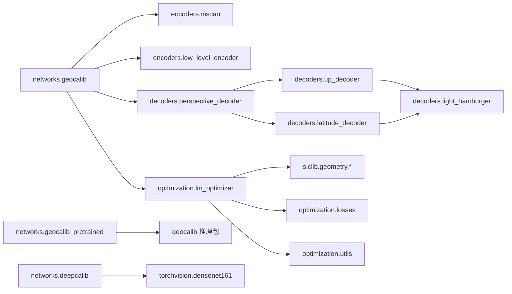

# 05 · `siclib` 模型体系

`siclib/models` 是训练/评估共用的模型框架。核心是**基于配置字符串的动态导入**与 `BaseModel` 统一接口。

## 1. 模型框架

### 1.1 `get_model(name)`

`siclib/models/__init__.py`：

```python
def get_model(name):
    # 依次尝试 name、siclib.models.name
    # 用 get_class(path, BaseModel) 找到模块内唯一的 BaseModel 子类
    # 若找不到，回退到模块的 __main_model__ 属性
```

因此配置里写 `networks.geocalib`、`encoders.mscan`、`decoders.up_decoder` 即可。

### 1.2 `BaseModel` / `MetaModel`

`siclib/models/base_model.py`：

- `MetaModel`：元类，自动合并父类的 `base_default_conf` 与 `default_conf`；
- `BaseModel(nn.Module)` 约定：
  - `default_conf`：默认配置；
  - `required_data_keys`：输入必须包含的键；
  - `_init(conf)`：子类初始化；
  - `_forward(data)`：返回预测字典；
  - `loss(pred, data)` / `metrics(pred, data)`：返回 `{name: Tensor[B]}`；
- 配置合并顺序：`base_default_conf → default_conf → 用户 conf`，并设为只读、结构化；
- 自动加载 `conf.weights`（若存在）；
- `flexible_load` 支持旧 checkpoint 的键名重映射（如 `gravity → up`、`*_head → *_head.decoder`）；
- `freeze_batch_normalization()` 把 BN 切到 eval。

### 1.3 `required_data_keys`

`BaseModel.__call__` 会检查输入字典是否包含这些键，缺失则报错。

## 2. 目录与职责

| 路径 | 职责 |
| --- | --- |
| `networks/geocalib.py` | 完整 GeoCalib 训练模型（backbone + 解码器 + 优化器 + loss） |
| `networks/geocalib_pretrained.py` | 包装 `geocalib` 推理包，用于评估预训练权重 |
| `networks/deepcalib.py` | DeepCalib 基线（DenseNet161 + 4 个分类头） |
| `networks/dust3r.py` | DUSt3R 相关辅助（可选） |
| `encoders/mscan.py` | MSCAN 骨干（SegNeXt） |
| `encoders/low_level_encoder.py` | 2 层卷积低层编码器 |
| `encoders/resnet.py` / `vgg.py` | 其他骨干 |
| `decoders/perspective_decoder.py` | 组合 up / latitude 两个头 |
| `decoders/up_decoder.py` | up 场预测 + 损失 + 指标 |
| `decoders/latitude_decoder.py` | 纬度场预测 + 损失 + 指标 |
| `decoders/light_hamburger.py` | LightHamHead / Hamburger 解码器 |
| `decoders/fpn.py` | FPN 解码器 |
| `optimization/lm_optimizer.py` | 训练用 LM 优化器（可微） |
| `optimization/inference_optimizer.py` | 推理配置（30 步、早停） |
| `optimization/losses.py` | squared / huber / barron / scaled |
| `optimization/utils.py` | 初始化、早停、λ 更新、Cholesky 步 |
| `optimization/perspective_opt.py` / `ransac.py` / `vp_from_prior.py` | 其他几何/鲁棒估计工具 |
| `utils/modules.py` | DropPath、DWConv、ConvModule、Dense 层等 |
| `utils/metrics.py` | 角度误差指标 |
| `utils/perspective_encoding.py` | up 分类编码/解码 |
| `cache_loader.py` | 从 h5 读取导出预测 |
| `extractor.py` | 推理接口 + `VP` 变体 |

## 3. GeoCalib 训练模型

`siclib/models/networks/geocalib.py`：

```python
class GeoCalib(BaseModel):
    default_conf = {
        "backbone": {"name": "encoders.mscan"},
        "ll_enc": {"name": "encoders.low_level_encoder"},
        "perspective_decoder": {"name": "decoders.perspective_decoder"},
        "optimizer": {"name": "optimization.lm_optimizer"},
    }
    required_data_keys = ["image"]
```

`_init`：

```python
self.backbone = get_model(conf.backbone["name"])(conf.backbone)
self.ll_enc = get_model(conf.ll_enc["name"])(conf.ll_enc) if conf.ll_enc else None
self.perspective_decoder = get_model(conf.perspective_decoder["name"])(conf.perspective_decoder)
self.optimizer = get_model(conf.optimizer["name"])(conf.optimizer) if conf.optimizer else None
```

`_forward`：

```python
backbone_out = self.backbone(data)
features = {"hl": backbone_out["features"], "padding": backbone_out.get("padding")}
if self.ll_enc: features["ll"] = self.ll_enc(data)["features"]
out = self.perspective_decoder({"features": features})
out |= {k: data[k] for k in ["image","scales","prior_gravity","prior_focal","prior_k1"] if k in data}
if self.optimizer: out |= self.optimizer(out)
return out
```

`loss`：

```python
losses, metrics = self.perspective_decoder.loss(pred, data)
total = losses["perspective_total"]
if self.optimizer:
    opt_losses, param_metrics = self.optimizer.loss(pred, data)
    losses |= opt_losses; metrics |= param_metrics
    total = total + opt_losses["param_total"]
losses["total"] = total
```

因此训练目标由两部分组成：

| 损失 | 来源 | 含义 |
| --- | --- | --- |
| `perspective_total` | `up_total + latitude_total` | 透视场预测的监督损失 |
| `param_total` | `LMOptimizer.loss` | 优化后相机/重力参数与 GT 的误差（可选） |
| `total` | 两者之和 | 反向传播目标 |

## 4. 预训练包装模型

`siclib/models/networks/geocalib_pretrained.py`：

```python
class GeoCalibPretrained(BaseModel):
    default_conf = {
        "camera_model": "pinhole",
        "model_weights": "pinhole",
    }
    def _forward(self, data):
        # 把 data 中的 prior_gravity / prior_focal 转成 geocalib 推理包的 priors
        # 调用 self.model.calibrate(data["image"], camera_model=..., priors=priors)
```

用途：评估配置 `geocalib-pinhole.yaml` / `geocalib-simple_radial.yaml` 时，直接加载官方权重，而不需要训练实验。

## 5. 编码器

### 5.1 `MSCAN`（`encoders/mscan.py`）

- 改编自 SegNeXt；
- `StemConv`：两次 stride-2 卷积，通道 `3 → embed_dims[0]/2 → embed_dims[0]`；
- 4 个 stage：
  - `OverlapPatchEmbed` 下采样；
  - 若干 `Block`（`AttentionModule` + `Mlp`）；
- `AttentionModule`：多尺度深度可分离卷积（5×5、1×7/7×1、1×11/11×1、1×21/21×1）+ 1×1；
- `Mlp`：1×1 → DWConv → GELU → 1×1；
- `DropPath` 随机深度；
- 输入先做 **RGB → BGR、×255**；
- 输出 `features` 列表（4 个尺度）及 `padding`。

### 5.2 `LowLevelEncoder`

两层 `ConvModule(3→64→64, k=3)`，输出 64 通道特征，提供高分辨率细节。

### 5.3 其他

`resnet.py`、`vgg.py` 提供标准骨干，便于替换实验。

## 6. 解码器

### 6.1 `PerspectiveDecoder`

```python
default_conf = {
    "up_decoder": {"name": "decoders.up_decoder"},
    "latitude_decoder": {"name": "decoders.latitude_decoder"},
}
```

- 可单独关闭 `up` 或 `latitude`（设为 `None`）；
- `_forward` 合并两个头的输出；
- `loss` 汇总为 `perspective_total`。

### 6.2 `UpDecoder`

```python
default_conf = {
    "loss_type": "l1",                 # l1 / l2 / dot / cauchy / huber / classification
    "use_loss": True,
    "use_uncertainty_loss": True,
    "loss_weight": 1.0,
    "recall_thresholds": [1, 3, 5, 10],
    "decoder": {"name": "decoders.light_hamburger", "predict_uncertainty": True},
}
```

- 线性头输出 2 通道（分类模式下 73 类）；
- `F.normalize` 得到单位 up 向量；
- 不确定性损失：用 `confidence / confidence.sum` 归一化后加权 L1；
- 指标：`up_angle_error`、`up_angle_error_weighted`、`up_angle_recall@1/3/5/10`。

### 6.3 `LatitudeDecoder`

结构类似，输出 1 通道；经 `tanh → asin` 映射到 `(-π/2, π/2)`；损失与指标对应 `latitude_angle_error` / `latitude_angle_recall@k`。

### 6.4 `LightHamHead`

- 多尺度输入投影到 `ham_channels`；
- `Hamburger` 用 `NMF2D` 做低秩矩阵分解式全局上下文建模；
- 输出上采样并融合，返回 `(features, log_confidence)`；
- `predict_uncertainty=True` 时额外输出置信度。

### 6.5 `FPN`

标准 FPN 解码器，作为替代方案。

## 7. 优化器

### 7.1 `LMOptimizer(BaseModel)`

`siclib/models/optimization/lm_optimizer.py` 默认配置：

```python
default_conf = {
    "camera_model": "pinhole",
    "shared_intrinsics": False,
    "num_steps": 10,
    "lambda_": 0.1,
    "fix_lambda": False,
    "early_stop": False,
    "atol": 1e-8, "rtol": 1e-8,
    "use_spherical_manifold": True,
    "use_log_focal": True,
    "loss_fn": "squared_loss",
    "up_loss_fn_scale": 1e-2,
    "lat_loss_fn_scale": 1e-2,
    "init_conf": {"name": "trivial"},
    "loss_weight": 1,
    "verbose": False,
}
```

与 `geocalib` 版本的主要差异：

| 特性 | `geocalib.lm_optimizer` | `siclib.lm_optimizer` |
| --- | --- | --- |
| 基类 | `nn.Module` | `BaseModel` |
| 默认步数 | 30 | 10 |
| 损失 | 固定 Huber | 可配 `squared_loss` / `huber_loss` / `barron` |
| 初始化 | `trivial` | `trivial` / `heuristic` / 其他模型 |
| 输出 | camera/gravity/uncertainty | 另加 `param_total` loss 与参数指标 |
| 多相机 rig | 支持 `camera_R_rig` | 通过配置/扩展支持 |

`loss(pred, data)` 计算优化后参数与 GT 的误差，并汇总为 `param_total`，用于训练时端到端监督。

### 7.2 `InferenceOptimizer`

继承 `LMOptimizer`，推理向配置：

```python
num_steps = 30
early_stop = True
loss_fn = "huber_loss"
```

### 7.3 损失函数

`siclib/models/optimization/losses.py`：

| 函数 | 说明 |
| --- | --- |
| `scaled_loss(x, fn, a)` | 前后缩放，返回 `(loss, d1, d2)` |
| `squared_loss(x)` | `x, 1, 0` |
| `huber_loss(x)` | 经典 Huber，含一阶/二阶导 |
| `barron_loss(x, alpha)` | 通用自适应鲁棒损失（CVPR 2019） |
| `scaled_barron(a, c)` | 返回带缩放的 Barron |

## 8. 几何工具

`siclib/models/optimization/utils.py`：

| 函数 | 说明 |
| --- | --- |
| `get_initial_estimation(data, camera_model, trivial_init)` | 选择 trivial / heuristic |
| `get_trivial_estimation` | `roll=0, pitch=0, vfov=0.7·max(h,w)` |
| `get_heuristic_estimation` | 从场中心/边界估计 roll/pitch/vFoV |
| `early_stop(new_cost, prev_cost, atol, rtol)` | 代价收敛判断 |
| `update_lambda(...)` | 阻尼自适应 |
| `optimizer_step(H, g, lambda_)` | Cholesky 求解 |

## 9. 指标

`siclib/models/utils/metrics.py`：

| 指标 | 含义 |
| --- | --- |
| `roll_error` | 预测 roll 与 GT 的角度差（度） |
| `pitch_error` | pitch 角度差 |
| `gravity_error` | 两个重力向量的夹角 |
| `vfov_error` | vFoV 角度差 |
| `dist_error` | 畸变参数差 |
| `up_error` | up 场逐像素夹角 |
| `latitude_error` | 纬度场逐像素角度差 |

训练配置中的 `median_metrics` / `recall_metrics` 会消费这些指标。

## 10. 预测缓存与推理接口

### 10.1 `CacheLoader`

`siclib/models/cache_loader.py`：

```python
class CacheLoader(BaseModel):
    default_conf = {
        "path": "???",              # 支持 "{scene}" 之类格式串
        "data_keys": None,
        "device": None,
        "trainable": False,
        "add_data_path": True,
        "collate": True,
        "scale": ["keypoints"],
        "padding_fn": None,
        "padding_length": None,
        "numeric_type": "float32",
    }
```

- 从 `predictions.h5` 按 `data["name"]` 读取每个样本的预测；
- 支持按 `scales` 反缩放；
- 用于评估阶段解耦“导出预测”与“计算指标”。

### 10.2 `siclib.models.extractor`

与 `geocalib.extractor` 类似，但：

- 支持 `weights` 为 checkpoint 路径；
- 从 checkpoint 的 `conf` 重建模型（`get_model(conf["name"])(conf)`）；
- 支持 `shared_intrinsics`，但不支持 `camera_R_rig`；
- 额外提供 `VP` 类（基于消失点的标定变体），用于 `pose_estimation.py` 的 `use_vp` 选项。

## 11. DeepCalib 基线

`siclib/models/networks/deepcalib.py`：

- 骨干：`DenseNet161`（可加载 ImageNet 预训练）；
- 4 个分类头：`roll`、`rho`、`vfov`、`k1_hat`；
- 每个头把连续参数离散为 bins，用交叉熵 + NLL 训练；
- `get_centers_and_edges` / `bins_to_val` 负责 bin ↔ 数值转换；
- `loss` 汇总各头 NLL，`metrics` 输出各参数误差。

配置见 `configs/model/deepcalib.yaml`、`configs/train/deepcalib.yaml`。

## 12. 模型依赖关系


