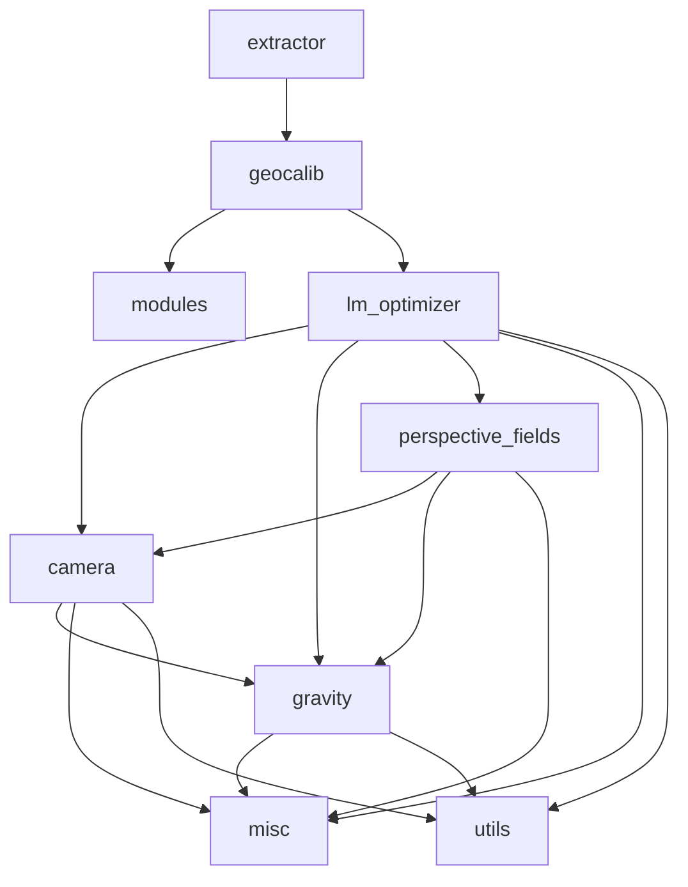

# 10 · 依赖关系

> 对应文件：`pyproject.toml`、`requirements.txt`、`siclib/pyproject.toml`、`siclib/requirements.txt`
> 相关文档：[01-architecture.md](./01-architecture.md)、[11-api-reference.md](./11-api-reference.md)

本章梳理 GeoCalib 的**外部依赖**、**包内模块依赖图**、**权重与数据依赖**，以及安装顺序。

---

## 1. 运行时外部依赖

### 1.1 `geocalib`（推理包）

| 包 | 用途 | 关键使用点 |
| --- | --- | --- |
| `torch` | 张量计算、`torch.func` 自动微分、`torch.hub` 下载 | 全包 |
| `torchvision` | 图像缩放、部分网络层 | `utils.ImagePreprocessor` |
| `opencv-python` (`cv2`) | 读写图像、重映射去畸变 | `utils.read_image`、`camera.undistort_image`、交互 demo |
| `kornia` | 可微图像 resize | `utils.ImagePreprocessor` |
| `matplotlib` | 可视化 | `viz2d.py`、demo |

`pyproject.toml`：包名 `geocalib` v1.0，`requires-python >= 3.9`，`packages = ["geocalib"]`，依赖从 `requirements.txt` 动态读取。

> `torch.func.jacfwd` / `vmap`（`geocalib/camera.py`、`gravity.py`）要求 **PyTorch ≥ 2.0**；`torch.compile`（训练）要求 ≥ 2.0。

### 1.2 `siclib`（训练/评估库）

在推理依赖基础上追加：

| 包 | 用途 |
| --- | --- |
| `omegaconf` | 结构化配置 |
| `hydra-core` | 配置组合与命令行覆盖 |
| `albumentations>=1.4,<2` | 数据增强（**版本上限 <2**） |
| `h5py` | 预测/结果缓存 |
| `pandas` | CSV 读写 |
| `tqdm` | 进度条 |
| `tensorboard` | 训练日志 |
| `wandb` | 训练日志（可选后端） |

`siclib/pyproject.toml` 使用 `packages.find`（`where=["."]`）收集所有子包。

### 1.3 可选 / 重型依赖

这些包**不在 requirements 中**，只有使用特定功能时才需要：

| 包 | 对应功能 | 位置 |
| --- | --- | --- |
| `poselib` | 绝对位姿估计（RANSAC） | `siclib/pose_estimation.py` |
| `pycolmap` | 位姿精化（gravity prior） | `siclib/pose_estimation.py` |
| `pymagsac` / `deeplsd` | 消失点基线（UVP） | `siclib/eval/configs/uvp.yaml`（`line_type: deeplsd`） |
| `scipy` | 参数分布采样 | `siclib/datasets/create_dataset_from_pano.py` |
| `PIL` | PIL resize 后端 | `siclib/utils/image.py` |
| `matplotlib` | 结果可视化 / 分布图 | 评估与数据集生成 |
| Gradio / `spaces` | Web demo | `gradio_app.py` |

> `siclib/eval/io.py` 还使用了 `pkg_resources`（setuptools），新版 Python 需确保 setuptools 可用。

### 1.4 硬件与系统

| 项 | 要求 |
| --- | --- |
| Python | ≥ 3.9 |
| GPU | 推理可在 CPU 运行；训练建议 CUDA（AMP/DDP/`torch.compile` 均针对 CUDA） |
| 显存 | 针孔训练 batch 24、径向训练 batch 18（配置已按 LM 显存开销调低） |
| DDP | `nccl` 后端 + 共享文件系统（`file://` 初始化锁） |
| 磁盘 | OpenPano 生成数据 + benchmark 数据 + checkpoint（数十 GB 量级） |

---

## 2. `geocalib` 包内模块依赖图

```
extractor.py  (GeoCalib 对外接口)
├── geocalib.py  (网络：MSCAN + LowLevelEncoder + PerspectiveDecoder + LMOptimizer)
│   ├── modules.py        MSCAN / ConvModule / LightHamHead
│   └── lm_optimizer.py
│       ├── camera.py     BaseCamera / Pinhole / SimpleRadial / Radial / SimpleDivisional
│       │   ├── gravity.py
│       │   ├── misc.py   TensorWrapper / autocast
│       │   └── utils.py  deg2rad / fov2focal / focal2fov / rad2rotmat
│       ├── gravity.py    (SphericalManifold / EuclideanManifold 来自 misc.py)
│       ├── perspective_fields.py
│       │   ├── camera.py
│       │   ├── gravity.py
│       │   └── misc.py   J_up_projection / J_vecnorm / SphericalManifold
│       └── misc.py       J_focal2fov
└── utils.py       ImagePreprocessor / load_image / 数学工具
viz2d.py          依赖 perspective_fields + utils
interactive_demo.py → extractor
```

依赖呈**分层结构**，无循环依赖（`camera` 依赖 `gravity`，`gravity` 不反向依赖 `camera`）：



---

## 3. `siclib` 包内模块依赖图

### 3.1 顶层依赖层次

```
train.py
├── datasets        get_dataset → BaseDataset → SimpleDataset
├── models          get_model  → BaseModel → 网络/解码器/优化器
├── eval            run_benchmark → EvalPipeline → SimplePipeline
├── utils           experiments / summary_writer / tools / tensor / stdout_capturing
└── settings        DATA_PATH / TRAINING_PATH / EVAL_PATH

eval/*.py
├── datasets        构造 test loader
├── models          CacheLoader / get_model / extractor
├── geometry        camera / gravity
├── utils           export_predictions / tools / experiments / conversions
└── visualization   visualize_batch / viz2d

models/networks/*
├── encoders        mscan / low_level_encoder / resnet / vgg
├── decoders        perspective_decoder / up_decoder / latitude_decoder / light_hamburger / fpn
├── optimization    lm_optimizer / inference_optimizer / losses / utils / perspective_opt / ransac / vp_from_prior
├── utils           metrics / modules / perspective_encoding
└── geometry        camera / gravity / perspective_fields

datasets/*
├── geometry        camera / gravity / perspective_fields
├── utils           image / conversions / tools / tensor
└── visualization   visualize_batch
```

### 3.2 关键依赖说明

| 模块 | 依赖 | 说明 |
| --- | --- | --- |
| `models/__init__.py` | `utils.tools.get_class` | 动态导入 |
| `models/base_model.py` | `omegaconf` | `MetaModel` 递归合并 `default_conf` |
| `models/cache_loader.py` | `h5py` | 读预测缓存，依赖 `BaseModel` |
| `models/networks/geocalib.py` | encoders + decoders + optimization | 组合成训练用模型 |
| `models/networks/geocalib_pretrained.py` | 外部 `geocalib` 包 | 包装推理接口 |
| `datasets/simple_dataset.py` | `geometry` + `utils.image` + `augmentations` | 构造样本 |
| `eval/simple_pipeline.py` | `datasets` + `models` + `geometry` + `visualization` | 评估主流程 |
| `pose_estimation.py` | `poselib` + `pycolmap` | 可选，用于位姿实验 |

### 3.3 两个包之间的耦合

- `siclib/models/networks/geocalib_pretrained.py` **直接导入** `geocalib` 包（`from geocalib import GeoCalib`），因此评估预训练权重时两个包都必须安装。
- `siclib/geometry/*`、`siclib/models/optimization/*` 是**独立重实现**，不依赖 `geocalib` 包。
- `train.py` 会把 `siclib` 自身（以及 `train.submodules`）复制进输出目录，`submodules` 为空时不复制 `geocalib`——但 `geocalib_pretrained` 仍需要环境中已安装该包。

---

## 4. 权重与数据依赖

### 4.1 预训练权重

| 权重 | 来源 | 用途 |
| --- | --- | --- |
| `geocalib-pinhole.tar` | GitHub Releases（`cvg/GeoCalib` v1.0），由 `torch.hub` 自动下载到 `~/.cache/torch/hub/geocalib/` | 推理包 `weights="pinhole"` |
| `geocalib-distorted.tar` | 同上，文件名 `distorted.tar` | 畸变推理 / 畸变评估 |
| `weights/mscan_b.pth` | **需手动准备**，SegNeXt MSCAN-B 骨干 | 训练针孔的骨干初始化 |
| `weights/geocalib.tar` | **需手动准备**，针孔训练好的完整模型 | 径向微调初始化 |
| `weights/deepcalib.tar` | **需手动准备** | DeepCalib 基线评估 |

> 仓库中**不包含** `weights/` 目录；训练/评估配置中的相对路径必须由使用者提供。

### 4.2 数据集

| 数据集 | 获取方式 | 依赖 |
| --- | --- | --- |
| OpenPano | `download_openpano.py` + `create_dataset_from_pano.py` | Laval 全景图（`data/laval-tonemap`） |
| LaMAR2k / MegaDepth2k / MegaDepth2k-Radial / TartanAir / Stanford2D3D | 评估时自动下载 zip | 网络 |
| OpenPano 测试集 | 本地生成 | 同上 |

---

## 5. 安装

### 5.1 仅推理

```bash
pip install -e .
# 或直接装依赖
pip install torch torchvision opencv-python kornia matplotlib
```

### 5.2 训练/评估

```bash
pip install -e .
pip install -e siclib
# 或
pip install -r requirements.txt -r siclib/requirements.txt
```

### 5.3 开发依赖

两个 `pyproject.toml` 的 `dev` 可选依赖：`black==23.9.1`、`flake8`、`isort==5.12.0`。代码风格：行宽 100，isort profile = black。

### 5.4 依赖完整性自检

```bash
python -c "import torch, torchvision, cv2, kornia, matplotlib; print('geocalib deps ok')"
python -c "import hydra, omegaconf, albumentations, h5py, pandas, tqdm; print('siclib deps ok')"
python -c "from geocalib import GeoCalib; print('geocalib import ok')"
python -c "from siclib.models.networks.geocalib_pretrained import GeoCalibPretrained; print('cross-package ok')"
```

---

## 6. 版本与兼容性注意

| 项 | 说明 |
| --- | --- |
| `albumentations>=1.4,<2` | 代码使用 `A.ImageOnlyTransform`、`A.OneOrOther` 等旧版 API；2.x 不兼容 |
| `torch.func` | `jacfwd`/`vmap` 需要 PyTorch ≥ 2.0 |
| `weights_only=False` | `BaseModel` 用 `torch.load(..., weights_only=False)`，需要可信权重来源 |
| `pkg_resources` | 依赖 setuptools，Python 3.12+ 默认不再自带，需显式安装 |
| `cv2` 的 EXR 支持 | `siclib/datasets/utils/tonemapping.py` 设置 `OPENCV_IO_ENABLE_OPENEXR=1` |
| 文件描述符 | 评估脚本把 `RLIMIT_NOFILE` 提升到 4096（h5 + 多 worker） |

---

## 7. 依赖清单速查

```
geocalib (推理)
├── torch >= 2.0
├── torchvision
├── opencv-python
├── kornia
└── matplotlib

siclib (训练/评估) = geocalib 的依赖 +
├── omegaconf
├── hydra-core
├── albumentations >=1.4,<2
├── h5py
├── pandas
├── tqdm
├── tensorboard
├── wandb
└── (可选) scipy / PIL / poselib / pycolmap / pymagsac / deeplsd / gradio
```

---

## 8. 相关文件索引

| 文件 | 内容 |
| --- | --- |
| `pyproject.toml` / `requirements.txt` | `geocalib` 包定义与依赖 |
| `siclib/pyproject.toml` / `siclib/requirements.txt` | `siclib` 包定义与依赖 |
| `hubconf.py` | `torch.hub` 入口 |
| `geocalib/misc.py` | 无第三方依赖的基础工具（`TensorWrapper`） |
| `siclib/settings.py` | 路径配置 |
| `siclib/__init__.py` | 全局 logger、`__module_name__` |
